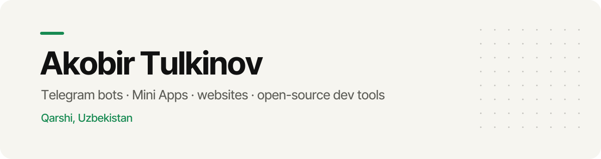
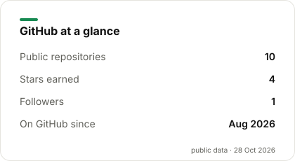
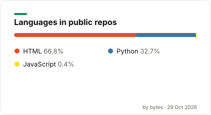

<picture>
  <source media="(prefers-color-scheme: dark)" srcset="assets/banner-dark.svg">
  
</picture>

  <picture>
    <source media="(prefers-color-scheme: dark)" srcset="https://readme-typing-svg.demolab.com/?font=Inter+Tight&weight=600&size=22&duration=3200&pause=900&color=3DDC84&center=true&vCenter=true&width=640&lines=Telegram+bots+%26+Mini+Apps;Websites+with+motion+and+WebGL;Open-source+tools+for+AI+coding+agents">
    
  </picture>

<b>Salom 👋 · Привет 👋 · Hi 👋</b>

I'm **Akobir Tulkinov**, a developer from Qarshi, Uzbekistan, and a student at IT Park. I build Telegram bots,
Mini Apps and websites with motion and WebGL, and I maintain open-source tools for developers who work with AI
coding agents.

  
  
  

## Featured: keelyard

<table><tr>
<td width="140" align="center"></td>
<td>

**[keelyard](https://github.com/akobirjontulqinovfuture/keelyard)** makes AI coding agents (Codex, Claude Code, OpenCode)
**prove their work, undo any step, and use fewer tokens**. The agent can't say "done" until the tests pass on the
current files, every edit is snapshotted for a one-command rewind, and noisy output is trimmed. Local only, no
telemetry, Apache-2.0.

`pip install keelyard` · [Codex in 2 minutes](https://akobirjontulqinovfuture.github.io/keelyard/codex/) · [Benchmarks you can rerun](https://github.com/akobirjontulqinovfuture/keelyard/blob/main/BENCHMARKS.md)

</td>
</tr></table>

## Now building

- **keelyard 1.1:** checked end to end inside the real Codex CLI, in CI on every push. Next: the same check for
  Claude Code and OpenCode, and a Gemini CLI adapter ([roadmap](https://github.com/akobirjontulqinovfuture/keelyard/blob/main/ROADMAP.md)).
- **Telegram Mini Apps and bots** for local businesses, like the [Bilim Plus Mini App](https://akobirjontulqinovfuture.github.io/bilimplus-miniapp/) for a learning center (Uzbek and Russian).

## Selected work

These are live demos. The public repos contain production builds only, and the source is private.

| | |
|---|---|
|  **[AKOBIR.OS](https://akobirjontulqinovfuture.github.io/akobir-os/)** Dashboard-style portfolio with a WebGL shader and motion, in three languages |  **[Farm demo](https://akobirjontulqinovfuture.github.io/farm-demo/)** German farm site concept with 3D and scroll storytelling |
|  **[EliteToolz v2 — The Vault](https://akobirjontulqinovfuture.github.io/elitetoolz-v2/)** Immersive WebGL redesign concept for a store |  **[EliteToolz](https://akobirjontulqinovfuture.github.io/elitetoolz-demo/)** Digital marketplace concept built with Three.js, GSAP and Lenis |
|  **[Edu Zone](https://akobirjontulqinovfuture.github.io/eduzone-demo/)** Website for a German language school |  **[Bilim+](https://akobirjontulqinovfuture.github.io/bilim-plus-demo/)** Website for a learning center, with motion |

<table><tr><td width="220"></td>
<td><b><a href="https://akobirjontulqinovfuture.github.io/bilimplus-miniapp/">Bilim Plus — Telegram Mini App</a></b> A course catalog, prices and sign-up for a free trial lesson, all inside Telegram. Available in Uzbek and Russian.</td></tr></table>

## Stack

  

## GitHub

  <picture>
    <source media="(prefers-color-scheme: dark)" srcset="assets/stats-dark.svg">
    
  </picture>
  <picture>
    <source media="(prefers-color-scheme: dark)" srcset="assets/langs-dark.svg">
    
  </picture>

  <picture>
    <source media="(prefers-color-scheme: dark)" srcset="https://streak-stats.demolab.com/?user=akobirjontulqinovfuture&hide_border=true&background=0D0D0D&ring=3DDC84&fire=3DDC84&currStreakLabel=3DDC84&sideLabels=F6F5F0&currStreakNum=F6F5F0&sideNums=F6F5F0&dates=9A9A93&stroke=333333">
    
  </picture>

Stats and languages are drawn from public GitHub data by <a href="scripts/cards.py">scripts/cards.py</a>, refreshed daily.

## Contact

Email [akobirtulqinov2@gmail.com](mailto:akobirtulqinov2@gmail.com) or visit [my portfolio](https://akobirjontulqinovfuture.github.io/).
I'm open to website, Telegram bot and Mini App projects.
