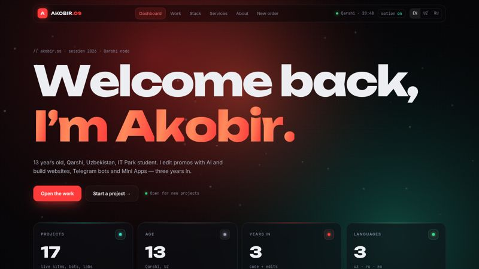
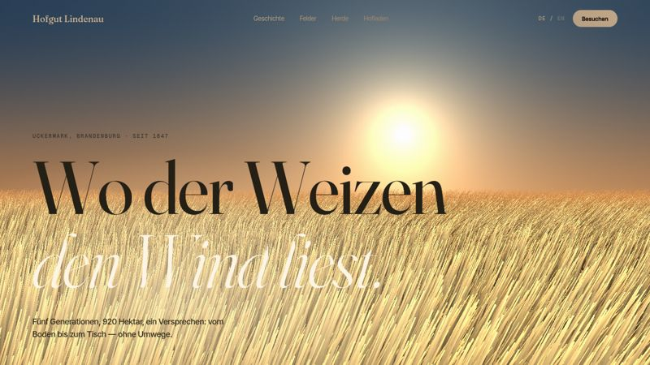
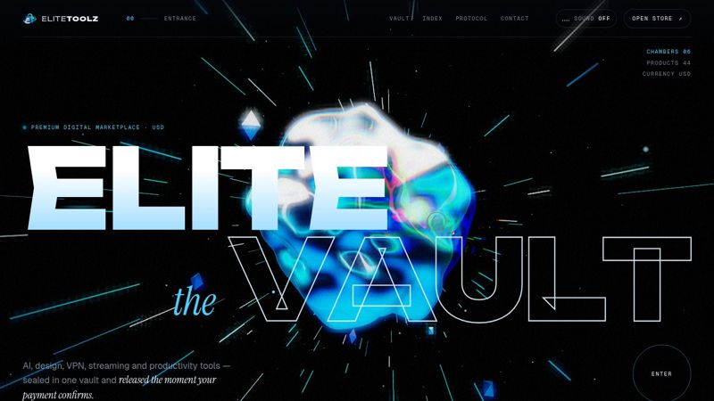
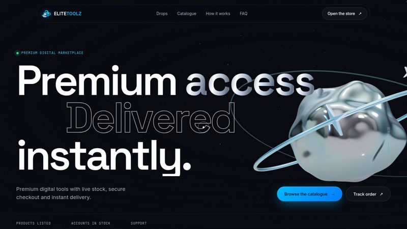
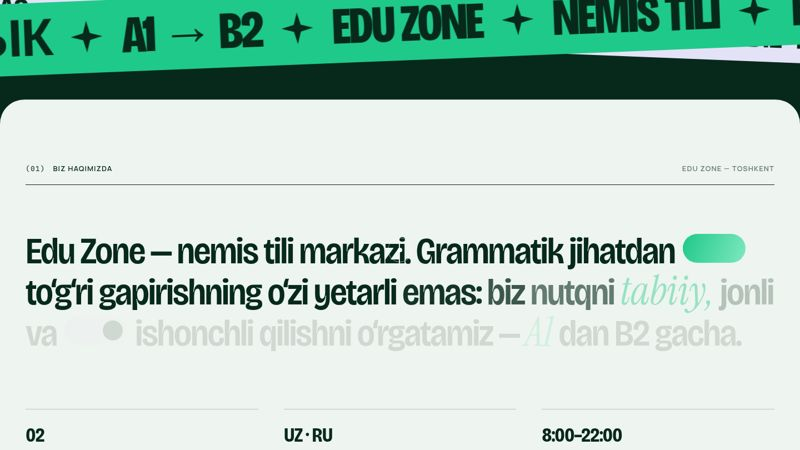
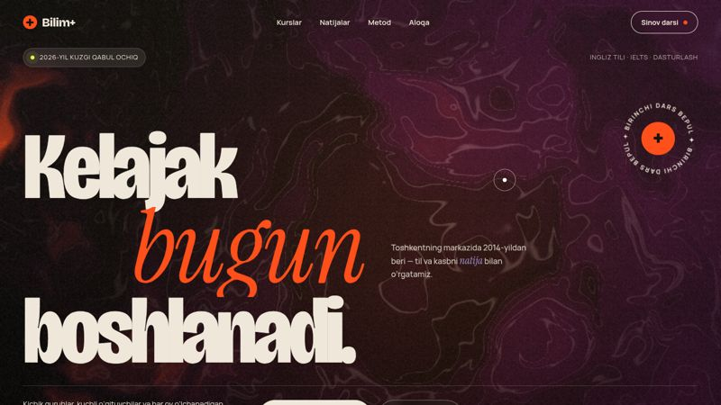
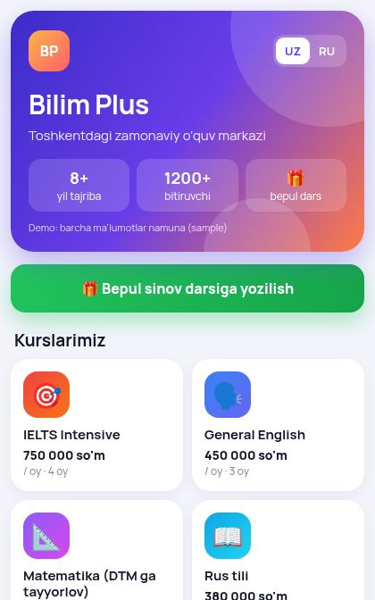

<b>Salom 👋 · Привет 👋 · Hi 👋</b>

I'm **Akobir**, a 13-year-old developer from Qarshi, Uzbekistan, and a student at IT Park. I build websites, Telegram bots and Mini Apps. I also edit videos with AI tools.

  
  
  

## ⚓ Featured: [keelyard](https://github.com/akobirjontulqinovfuture/keelyard)

keelyard is an open-source tool that makes AI coding agents (Claude Code, Codex, OpenCode) **prove their work, undo any step, and use fewer tokens**.

| | |
|---|---|
| **~80% fewer tokens** | Measured across a 6-task session benchmark. Per-task savings were 77–85%. |
| **Same quality** | With keelyard, 100% of benchmark tasks were completed correctly. |
| **Proof before "done"** | Each claim is checked against tests and file hashes. |
| **Rewind** | Restores files to any earlier step with one command. |

The benchmark is in the repo ([`bench/session`](https://github.com/akobirjontulqinovfuture/keelyard/tree/main/bench/session)), so you can rerun it yourself.

## 🖥 Selected work

These are live demos. The public repos contain production builds only, and the source is private.

| | |
|---|---|
|  **[AKOBIR.OS](https://akobirjontulqinovfuture.github.io/akobir-os/)** Dashboard-style portfolio with a WebGL shader and motion, in three languages |  **[Farm demo](https://akobirjontulqinovfuture.github.io/farm-demo/)** German farm site concept with 3D and scroll storytelling |
|  **[EliteToolz v2 — The Vault](https://akobirjontulqinovfuture.github.io/elitetoolz-v2/)** Immersive WebGL redesign concept for a store |  **[EliteToolz](https://akobirjontulqinovfuture.github.io/elitetoolz-demo/)** Digital marketplace concept built with Three.js, GSAP and Lenis |
|  **[Edu Zone](https://akobirjontulqinovfuture.github.io/eduzone-demo/)** Website for a German language school |  **[Bilim+](https://akobirjontulqinovfuture.github.io/bilim-plus-demo/)** Website for a learning center, with motion |

<table><tr><td width="220"></td>
<td><b><a href="https://akobirjontulqinovfuture.github.io/bilimplus-miniapp/">Bilim Plus — Telegram Mini App</a></b> A course catalog, prices and sign-up for a free trial lesson, all inside Telegram. Available in Uzbek and Russian.</td></tr></table>

## 🧰 Stack

## 📫 Contact

You can reach me at [akobirtulqinov2@gmail.com](mailto:akobirtulqinov2@gmail.com) or through [my portfolio](https://akobirjontulqinovfuture.github.io/). I'm open to website, Telegram bot and Mini App projects.
